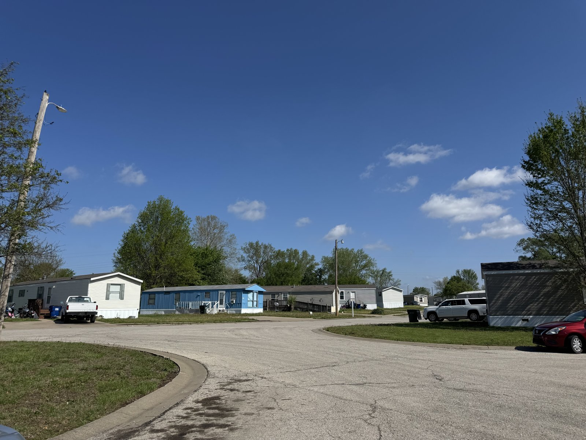
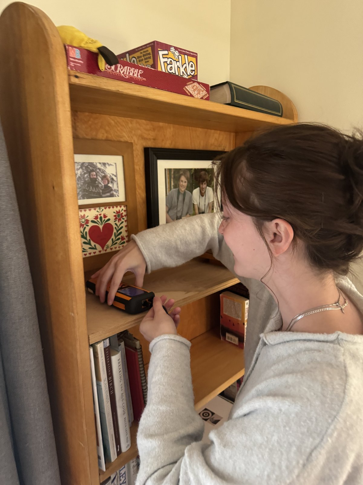
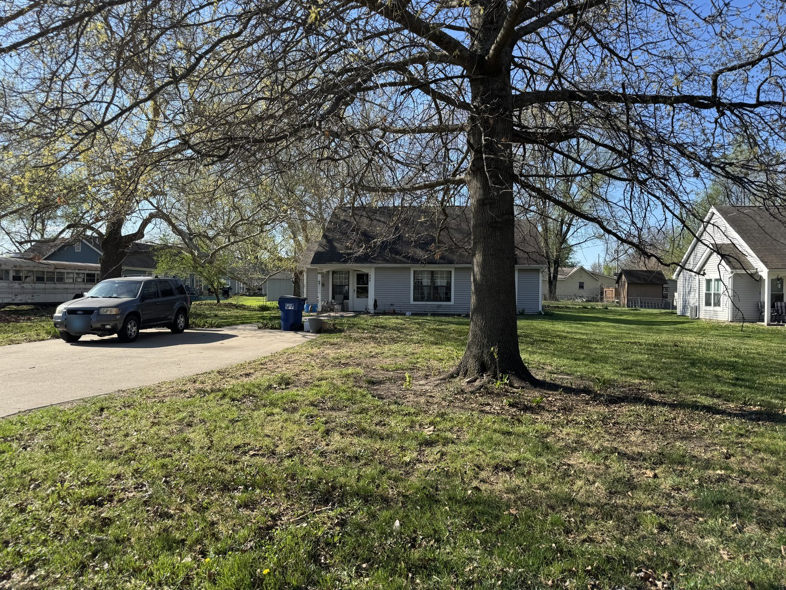

In Spring 2026, I developed **“Data Science for Health and Well-Being”** at the University of Kansas, a research-oriented course for undergraduate students, with support from the **Kansas NSF EPSCoR** team.

In this course, students worked on a real research project from start to finish: recruiting participants, installing indoor air quality (PM2.5) sensors in homes, collecting survey data, and analyzing the data.

